# Home Camera Vault: Technical Documentation

A home security camera app in which **authority over footage emerges only when the household agrees**. The camera vendor (CamCo) operates every server, including TideCloak, and still cannot watch, release, or grant itself access to any clip.

This document covers the architecture, every workflow (with diagrams), the security model, the API, operations, and the problems hit while building it. For the short version and the demo click path, see the [README](../README.md).

> Diagrams are written in Mermaid. They render on GitHub, in the VS Code Markdown preview (built in), and in most Markdown viewers.

---

## Contents
1. [Concepts in one page](#1-concepts-in-one-page)
2. [System architecture](#2-system-architecture)
3. [Who can do what](#3-who-can-do-what)
4. [Roles and the vault policy](#4-roles-and-the-vault-policy)
5. [Workflow: encrypted capture](#5-workflow-encrypted-capture)
6. [Workflow: viewing a clip](#6-workflow-viewing-a-clip)
7. [Workflow: the vendor tries to look](#7-workflow-the-vendor-tries-to-look)
8. [Workflow: the vendor tries to grant itself access](#8-workflow-the-vendor-tries-to-grant-itself-access)
9. [Workflow: quorum adds a member](#9-workflow-quorum-adds-a-member)
10. [Workflow: someone leaves (revocation)](#10-workflow-someone-leaves-revocation)
11. [Change-request lifecycle](#11-change-request-lifecycle)
12. [Live camera and motion detection](#12-live-camera-and-motion-detection)
13. [Bootstrap and first-time setup](#13-bootstrap-and-first-time-setup)
14. [Data model](#14-data-model)
15. [API reference](#15-api-reference)
16. [Code map](#16-code-map)
17. [Operations: scripts and commands](#17-operations-scripts-and-commands)
18. [Troubleshooting](#18-troubleshooting)
19. [Known limits and design trade-offs](#19-known-limits-and-design-trade-offs)
20. [Glossary](#20-glossary)
21. [Many households: sign-up and provisioning](#21-many-households-sign-up-and-provisioning)
22. [CamCo staff: sign-in and operations](#22-camco-staff-sign-in-and-operations)
23. [Household copies: surviving vendor deletion](#23-household-copies-surviving-vendor-deletion)

---

## 1. Concepts in one page

| Idea | What it means here |
|---|---|
| **No master key** | Each clip has its own AES-256-GCM key. That key is wrapped by the **Tide network**: 20 independent ORK servers, any 14 of which must cooperate. The key that can unwrap it is never assembled anywhere: not at CamCo, not in TideCloak, not in the browser. |
| **The network enforces the rule** | Wrapping uses a signed policy (`RelationshipAttestation:1`). On every unwrap, each ORK checks the caller's credential: *do they hold the `household-viewer` role and `_tide_decryptor`?* If not, every ORK refuses. |
| **Quorum governance (IGA)** | TideCloak's Identity Governance turns every admin change (grant a role, remove a user, add an owner) into a **change request**. It applies only when enough owners (`tide-realm-admin`) sign it in their own **Tide enclave**. With 3 owners the threshold is **2**. |
| **Root is just a requester** | CamCo holds TideCloak's master-admin password. On this realm that lets it *file* requests (HTTP 202/204, "captured") but not approve or commit them: approving needs an owner's enclave signature, and root has no Tide key. |
| **Ciphertext-only storage** | CamCo's backend stores the clip ciphertext, the IV and the wrapped key. Nothing it stores can be opened with anything it holds. |

---

## 2. System architecture

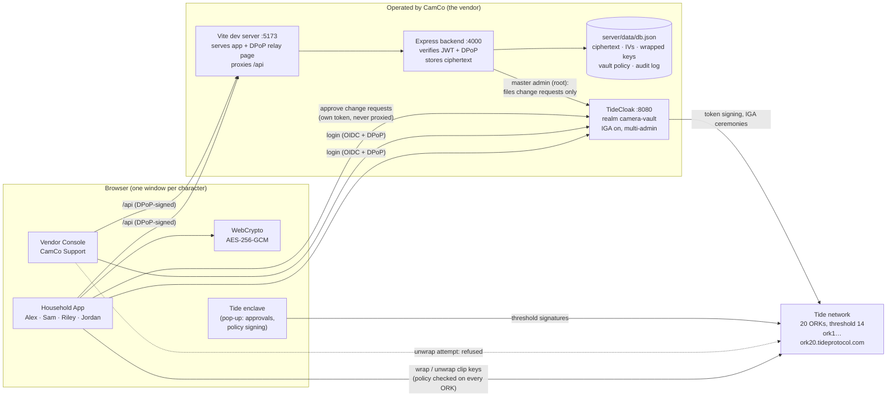

**Trust boundaries**
- Everything in the **CamCo** box is assumed hostile or compromised: the server, the database, TideCloak and its root account.
- **Tide network:** no single ORK can decrypt or sign alone.
- **Browser:** the only place plaintext exists, briefly, for the person allowed to see it.

---

## 3. Who can do what

| Action | Alex / Sam / Riley (owners) | Jordan (before approval) | Jordan (after approval) | CamCo Support | CamCo root admin |
|---|---|---|---|---|---|
| Record + upload an encrypted clip | ✅ | ❌ (API 403) | ✅ | ❌ | ❌ |
| Read raw stored rows | — | — | — | ✅ (it's their DB) | ✅ |
| Decrypt / play a clip | ✅ | ❌ | ✅ | ❌ **network refuses** | ❌ no Tide identity |
| File a role change | ✅ (via app) | ❌ | ❌ | ✅ (as root) | ✅ |
| **Approve** a role change | ✅ (enclave signature) | ❌ | ❌ | ❌ | ❌ **409 / refused** |
| Make a change apply alone | ❌ needs 2 of 3 | ❌ | ❌ | ❌ | ❌ **412 / quorum not met** |
| Remove their own access | ❌ (server 403) | — | ❌ | — | — |
| Delete clips | ✅ any clip | — | ✅ own uploads only | ❌ no household route. CamCo can destroy ciphertext on its own disks (demo: **Delete ciphertext**), a denial of service, never a disclosure, and households keep their own copy (§23) | ❌ |

---

## 4. Roles and the vault policy

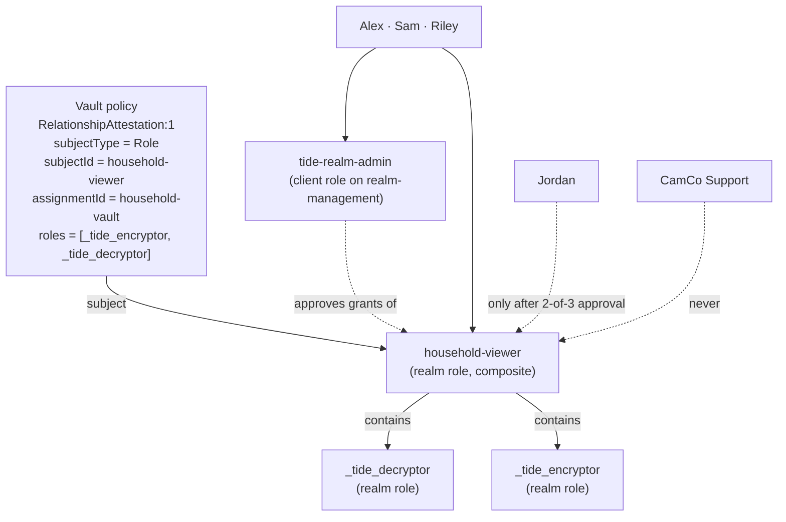

| Role | Kind | Purpose |
|---|---|---|
| `household-viewer` | realm role, **composite** | Membership. The vault policy's subject. Carries `_tide_decryptor` + `_tide_encryptor`, so joining is **one** governed grant. |
| `_tide_decryptor` / `_tide_encryptor` | realm roles (names fixed by the ORK contract) | Capability checks the contract makes on every decrypt / encrypt. |
| `tide-realm-admin` | client role on `realm-management` | Owner / approver. Who can sign change requests. Threshold = `max(1, floor(0.7 × owners))`, encoded in the signed admin policy: 3 owners → **2**. |

**The vault policy** is signed **once**, by an owner, in the Tide enclave ("Create vault"). Because its subject is a **role**, adding or removing people never needs a new policy: it's just a governed role change. One record id (`household-vault`) is the only tag on every wrapped key.

---

## 5. Workflow: encrypted capture

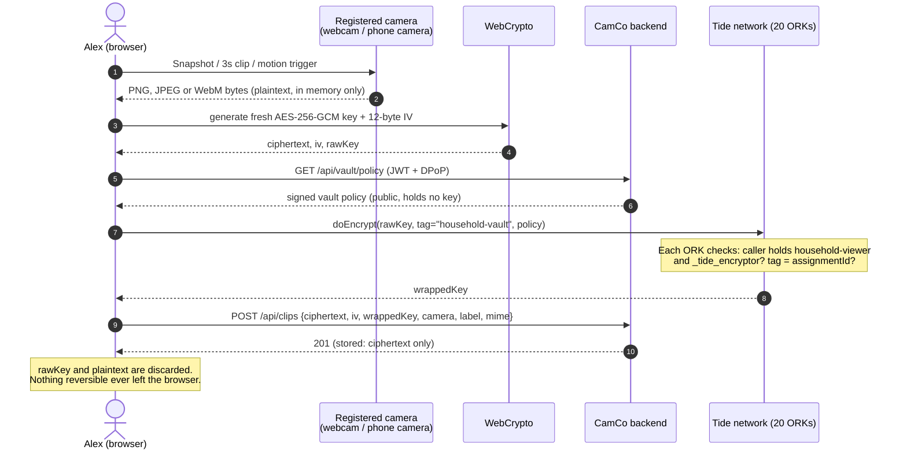

**Why wrap a key instead of encrypting the video with Tide directly?** Videos are large, and Tide's per-call encryption is meant for small payloads. Wrapping only the 32-byte key keeps calls fast. Tide itself uses the same hybrid pattern (AES-GCM + threshold ElGamal) for data ≥ 32 bytes.

---

## 6. Workflow: viewing a clip

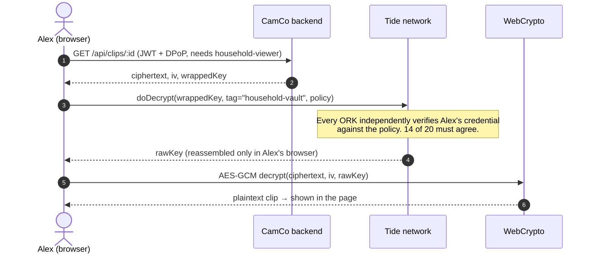

The backend's own role check (403 for non-members) is a **convenience**. The **real** gate is the network: even someone holding a copy of the ciphertext and wrapped key cannot get the key without the role.

---

## 7. Workflow: the vendor tries to look

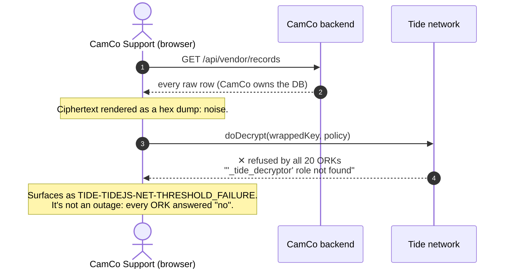

---

## 8. Workflow: the vendor tries to grant itself access

This is the key demo moment.

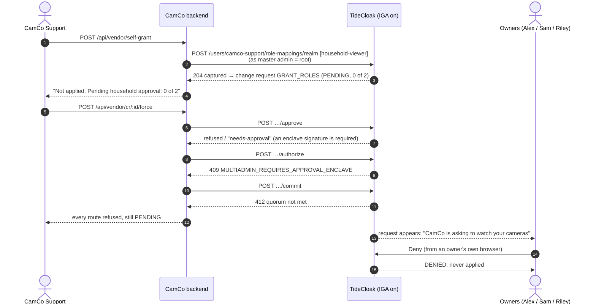

The status codes on the `approve`/`authorize`/`commit` steps are the answers documented for TideCloak's IGA API. The Vendor Console shows whatever TideCloak actually returns, verbatim. The captured `204` and the `0 of 2` pending state were observed on this realm.

Root can **file** but never **approve**: approval is a threshold signature that needs an owner's Tide key, which only exists split across the ORK network and is unlocked by that owner's own login.

---

## 9. Workflow: quorum adds a member

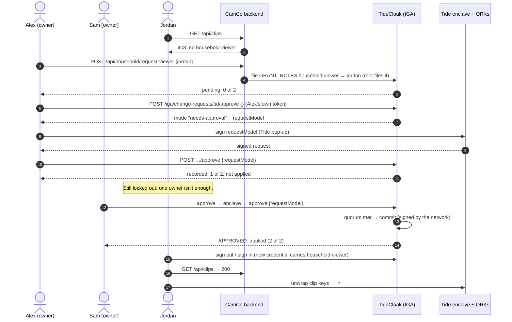

Approvals go **browser → TideCloak directly** with each owner's own DPoP-bound token. Proxying them through a server would credit every signature to one account, and the tally would stick at 1.

---

## 10. Workflow: someone leaves (revocation)

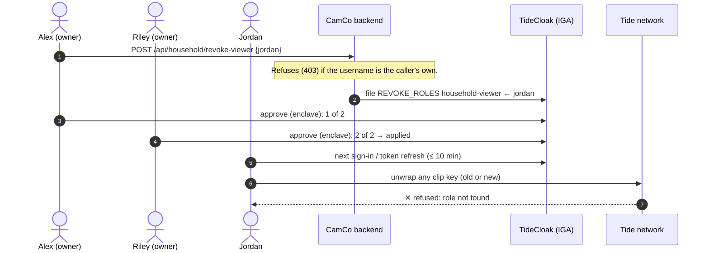

No re-encryption is needed: the policy names the **role**, so removing the role closes every clip at once.

---

## 11. Change-request lifecycle

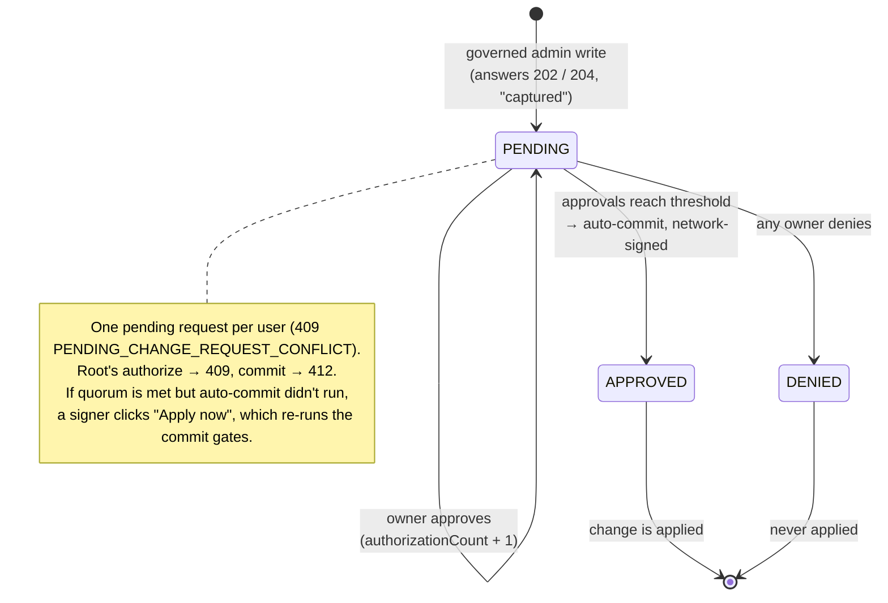

| Status | Meaning |
|---|---|
| `PENDING` | Waiting for approvals. `authorizationCount` of `threshold`. |
| `APPROVED` | **Committed and applied.** |
| `DENIED` | Rejected; never applied. |

---

## 12. Live camera and motion detection

A household registers **several cameras** (owners add or remove them; a name and a location, which CamCo can see as metadata). Each camera tile is fed by a video device on a member's computer: a phone camera, a laptop webcam, any capture device. Which device feeds which camera is remembered in that browser. Each tile has its own preview, snapshot and record buttons, **its own motion detection** and its own upload progress, so several cameras can run and trigger at once. Every clip is tagged with its camera and goes through the same encrypt pipeline.

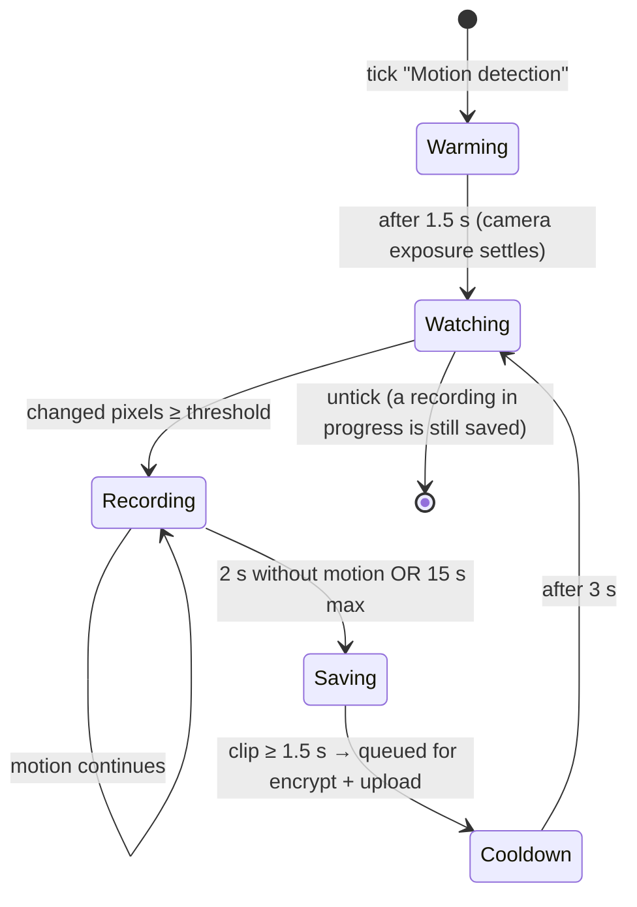

**How motion is measured.** About 5 times a second, the frame is drawn onto a 64×36 canvas and converted to greyscale. The *motion level* is the share of pixels whose brightness changed by more than 28 (on a 0–255 scale). The trigger threshold comes from the sensitivity slider: `(101 − sensitivity) / 1000`, so the default of 60 means 4.1% of pixels. This all runs in the browser; no frame is ever uploaded unencrypted.

**Recording.** Frames are letterboxed into 640×360, stamped with "● LIVE camera + UTC time", and recorded at 15 fps, about 600 kbps WebM. Uploads are serialised so overlapping events don't clash.

---

## 13. Bootstrap and first-time setup

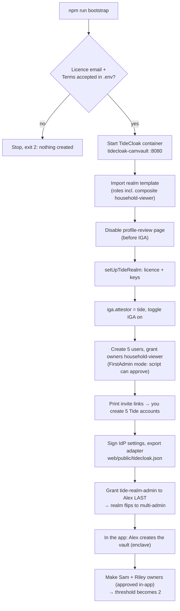

**Why the order matters.** Until the first `tide-realm-admin` grant commits, the realm is in *FirstAdmin* mode and the script can approve its own changes. After the flip, **every** change needs a human enclave signature. That's the property the demo relies on, so the script does everything it needs before the flip and stops there.

---

## 14. Data model

`server/data/db.json` (gitignored):

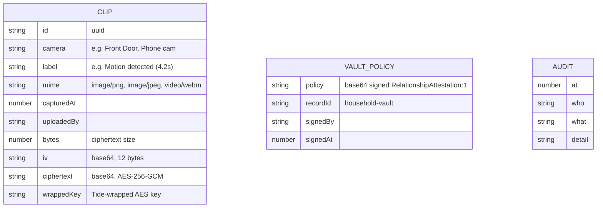

| What CamCo can read | What it can't |
|---|---|
| Camera name, label, time, size, uploader, IV, ciphertext, wrapped key, the (public) vault policy | The clip, the AES key, anything that unwraps the key |

---

## 15. API reference

Every route except `/api/health` verifies the **Tide JWT** (embedded JWKS, issuer, `azp`) **and** the **DPoP proof** (RFC 9449: key thumbprint, `ath`, `htm`, `htu`, `iat`, one-time `jti`). Role checks use the verified token, never anything from the browser.

| Method | Path | Who | Purpose |
|---|---|---|---|
| GET | `/api/health` | anyone | liveness |
| GET | `/api/households/:id` | anyone with the code | household name and status |
| GET | `/api/households/:id/adapter` | anyone with the code | that realm's public sign-in config |
| POST | `/api/signup` | anyone (3/hour/IP) | start provisioning a new household |
| GET | `/api/staff-realm` | anyone | which realm the `/staff` page signs in to |
| GET | `/api/signup/:token` | the person who signed up | provisioning progress + first owner's invite link |
| GET | `/api/me` | signed in | username, roles, owner / household / vendor flags |
| GET | `/api/vault/status` | signed in | has the vault been created, by whom |
| GET | `/api/vault/policy` | household | the signed vault policy |
| PUT | `/api/vault/policy` | owner | store the policy after enclave signing |
| GET | `/api/admin-policy` | owner | realm admin policy, needed to sign the vault policy |
| GET | `/api/cameras` | household | the household's registered cameras |
| POST | `/api/cameras` | owner | register a camera (name, location; max 16) |
| DELETE | `/api/cameras/:id` | owner | remove a camera (its clips are kept) |
| POST | `/api/clips` | household | upload ciphertext + wrapped key, tagged with a registered `cameraId` |
| GET | `/api/clips` | household | list event metadata |
| GET | `/api/clips/:id` | household | one clip's ciphertext + wrapped key |
| POST | `/api/clips/delete` | household | delete clips by id: owners any, others only their own uploads |
| GET | `/api/clips/tombstones` | household | deliberate deletions (household or retention), to tell them apart from silent loss |
| GET | `/api/storage` | household | used vs allowance, snapshots/videos, per-camera breakdown, retention |
| PUT | `/api/storage/retention` | owner | auto-delete after 7, 30 or 90 days, or keep (`null`) |
| GET | `/api/settings` | signed in | household settings (timezone) |
| PUT | `/api/settings/timezone` | owner | set the household timezone (IANA name, validated) |
| GET | `/api/directory` | signed in | user-id → name and role-id → name, for readable approvals |
| GET | `/api/household/members` | owner | live member status from TideCloak |
| POST | `/api/household/request-viewer` | owner | **file** a `household-viewer` grant |
| POST | `/api/household/revoke-viewer` | owner (not self) | **file** a `household-viewer` removal |
| POST | `/api/household/request-owner` | owner | **file** a `tide-realm-admin` grant |
| POST | `/api/household/invite` | owner | **file** CREATE_USER for a new person (no access) |
| POST | `/api/household/invite-link` | owner | 12h Tide account link for someone not yet linked |
| GET | `/api/audit` | household / vendor | recent events |
| GET | `/api/household/notices` | household | everything CamCo did that touched this household |
| GET | `/api/vendor/households` | CamCo staff | every household: status, cameras, clips, storage, last upload |
| GET | `/api/vendor/ops` | CamCo staff | service health: TideCloak, 20 ORKs, storage totals |
| GET | `/api/vendor/fleet?household=` | CamCo staff | per-camera events, last seen, bytes |
| POST | `/api/vendor/households/:id/reissue-link` | CamCo staff | fresh setup link, only while waiting for the owner |
| POST | `/api/vendor/clips/:id/destroy?household=` | CamCo staff | demo of the availability threat: deletes ciphertext with no tombstone |
| GET/POST | `/api/vendor/legal-requests` | CamCo staff | log a request for footage; the household is notified |
| GET | `/api/vendor/records?household=` | CamCo staff | raw DB rows |
| GET | `/api/vendor/change-requests` | CamCo staff | pending requests as root sees them |
| POST | `/api/vendor/self-grant` | CamCo staff | root tries to grant itself `household-viewer` |
| POST | `/api/vendor/cr/:id/force` | CamCo staff | root tries `approve`, `authorize`, `commit` |

**Browser → TideCloak, never via the backend:** `GET /iga/change-requests?status=PENDING`, and `POST /iga/change-requests/:id/approve` (two calls with the enclave signature in between) and `…/deny`, each with the owner's own DPoP token.

---

## 16. Code map

```
scripts/
  bootstrap.mjs          Full setup (ported from Tide's bootstrap-tidecloak.sh to Node, cross-platform)
  cast.mjs               After setup: status | add | remove | grant | composite | invite
  realm.json.template    Realm, client, mappers, roles (household-viewer composite)
server/src/
  index.ts               All API routes
  auth/tide.ts           JWT verification + requireAuth (JWT + DPoP on every route)
  auth/verifyDpop.ts     Tide pack's RFC 9449 verifier (unchanged copy)
  tidecloakAdmin.ts      Root (master admin) client: files change requests, reads members
  db.ts, paths.ts        JSON store and paths
web/src/
  Home.tsx               Signed-out home page
  App.tsx                Auth callback, routing by identity (Household vs Vendor)
  household/Household.tsx  Vault setup, gallery/viewer, approvals, members, notices
  household/Cameras.tsx    Registered cameras: one tile each (device, preview, capture, motion)
  vendor/VendorConsole.tsx Raw storage, refused decrypt, self-grant + force attempts
  camera/live.ts         Real camera: open, snapshot, recorder
  camera/motion.ts       Frame-differencing motion detector
  lib/crypto.ts          AES-256-GCM (WebCrypto)
  lib/vault.ts           Vault policy signing, key wrap/unwrap, refusal parsing
  lib/tide/relationship.ts Tide pack's RelationshipAttestation helper (unchanged copy)
  lib/iga.ts             Change requests: list, two-phase approve, deny, labels
  lib/api.ts             secureFetch wrappers (DPoP on every call)
web/vite.config.ts       SDK DPoP relay plugin, frame-src CSP, /api proxy
```

---

## 17. Operations: scripts and commands

| Task | Command |
|---|---|
| Install | `npm run setup` |
| First-time setup | `npm run bootstrap` |
| Finish setup with fewer linked accounts | `RESUME_FROM=finish npm run bootstrap` |
| Start over (deletes the realm + container) | `FORCE_WIPE=1 npm run bootstrap` |
| Run | `npm run server` and `npm run web` |
| After reboot | `docker start tidecloak-camvault`, then run both |
| Who's in the realm, what's pending | `node scripts/cast.mjs status` |
| Add a person (files CREATE_USER) | `node scripts/cast.mjs add riley owner` |
| Give an owner the vault role (files GRANT_ROLES) | `node scripts/cast.mjs grant riley owner` |
| New invite link | `node scripts/cast.mjs invite riley` |
| Remove a person (files DELETE_USER) | `node scripts/cast.mjs remove riley` |
| Typecheck everything | `npm run typecheck` |
| TideCloak admin console | <http://localhost:8080/admin/master/console/> (user `admin`, password from `.env`), realm `camera-vault` |

Every `cast.mjs` command only **files** a request; an owner approves it in the app under **Pending household approvals**.

---

## 18. Troubleshooting

Problems met while building this, and their fixes.

| Symptom | Cause | Fix |
|---|---|---|
| TideCloak exits: `Could not open file …keycloakdb.mv.db` | A named Docker volume is root-owned; the container runs as uid 1000 | The script uses no volume; data lives in the container (survives `docker stop/start`) |
| `error-user-attribute-required: email` | The user profile requires an email | Characters get `…@household.invalid` (a reserved, undeliverable TLD) |
| `Could not reach enough NEW ORKs (… 18 of 20 failed)` / `NET-FETCH_FAILED` at sign-up | The browser couldn't reach the ORKs: ad-blocker, privacy shields, VPN, or a stale tab | Fresh private window, extensions off, one account at a time, unique username |
| `hit its user limit` at sign-up | Free-tier licence account cap | Ask Tide to raise it, or `RESUME_FROM=finish` |
| Invite page: *Invalid username or password* | The link belongs to a deleted user | `node scripts/cast.mjs invite <user>` for a fresh link |
| `'_tide_encryptor' role not found` from all ORKs | Role missing from the credential | Grant it; the user signs out and in |
| Granting 3 roles only gave 1 | IGA records only the **first** role of a multi-role POST | One role per request (now everywhere) |
| Second grant → `409` | One pending change request per user | Make `household-viewer` a composite, so membership is one grant |
| Approved "1 of 1" but not applied | Auto-commit didn't run | **Apply now (quorum reached)** re-runs the commit gates |
| Server prints "running" but old code serves | Express 5 calls the listen callback even on `EADDRINUSE` | The callback now exits on error; stop the old process first |
| Vite: `Cannot read properties of undefined (reading 'url')` | A `configureServer` hook returned a function (Vite runs it as a post hook) | Block body in the plugin |
| Live camera black / nothing happens | Wrong device, phone not connected, or no frames | Pick the **phone camera** or webcam; read the status line (*receiving frames* vs *no picture*) |
| A refused decrypt looks like an outage | Contract refusals arrive as `THRESHOLD_FAILURE` | The app reads the ORKs' reasons and says "refused", without retrying |

---

## 19. Known limits and design trade-offs

- **Metadata isn't hidden.** CamCo sees camera names, times, sizes and who uploaded. Hiding these would need encrypted metadata and padding.
- **Revocation is eventual.** It applies at the next sign-in or token refresh (access tokens last 10 minutes). Anything already decrypted and saved can't be recalled.
- **The vault is one record.** All clips share `household-vault`, so access is all-or-nothing per household. Per-camera or per-clip sharing (e.g. releasing one clip to police) would add records and policies.
- **CamCo can still deny service** (delete ciphertext, go offline), but it no longer holds the only copy: households keep their own encrypted copies and detect silent deletions (§23). A deletion record CamCo forges would hide a deletion from the check, but not destroy the household's copy. Making those records trustworthy would need them signed by the deleting member's own key.
- **Vendor staff are identified by username** (`VENDOR_STAFF`, default `camco-support`) for the demo console. Their *lack* of access is enforced by Tide, not by that list.
- **Development setup.** HTTP on localhost, an H2 database inside the container, and an in-memory DPoP replay store (single process).

---

## 20. Glossary

| Term | Meaning |
|---|---|
| **TideCloak** | Keycloak-based identity server whose keys and signatures are threshold-split across the Tide network |
| **ORK** | One of the Tide network's independent key servers; each holds only a fragment |
| **Threshold (14 of 20)** | How many ORKs must cooperate for any key operation |
| **Enclave** | Tide's isolated pop-up where a user approves and signs, separate from the app's page |
| **IGA / change request** | Identity Governance: admin changes are captured as requests and applied only at quorum |
| **Quorum / threshold (2 of 3)** | How many owners must sign a change request |
| **`tide-realm-admin`** | The owner/approver role |
| **RelationshipAttestation:1** | Built-in ORK contract: "holders of role X may encrypt/decrypt data tagged Y" |
| **Wrapped key** | The clip's AES key, encrypted by the Tide network under the vault policy |
| **DPoP** | Proof-of-possession: each API call is signed by a key bound to the token, so a stolen token can't be replayed |
| **Root / master admin** | TideCloak's `admin` account in the `master` realm, held by CamCo |

---

## 21. Many households: sign-up and provisioning

**One TideCloak realm per household.** TideCloak's quorum (IGA) is realm-wide. In one shared realm, every family's owners would approve everyone's changes, and the threshold would be 70% of *all* owners. A realm per household gives each family its own keys on the Tide network, its own owners and its own 2-of-3 quorum. The household from `npm run bootstrap` is registered as the first one, *The Demo Household* (`camera-vault`).

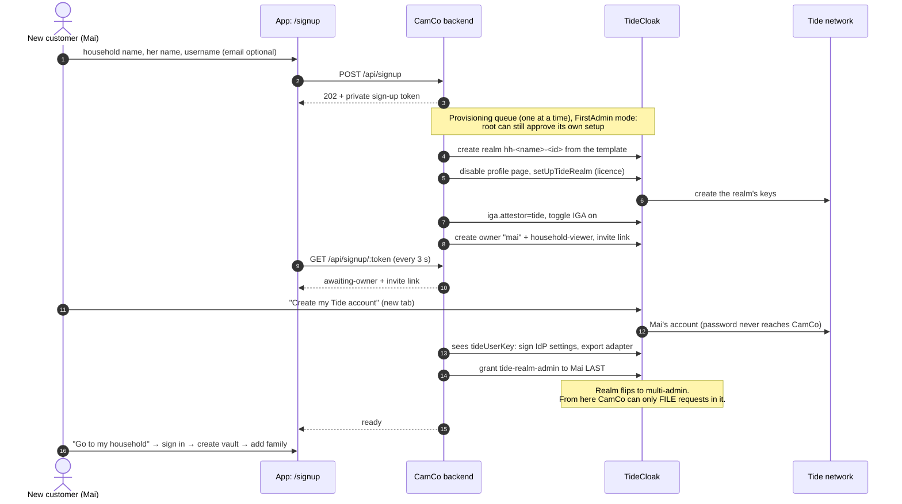

**How the pieces find each other**

| Piece | How it knows the household |
|---|---|
| Browser | The household code is stored locally (`camvault.household`). At start-up the app fetches that realm's adapter from `/api/households/:id/adapter`, then starts the Tide provider with it. Switching household reloads the page. |
| Backend | Each request's token `iss` names a realm. The backend picks that household, then verifies the token against **that realm's** key, and uses that household's data folder (`server/data/households/<id>/`). |
| DPoP relay page | Accepts the issuer + client of any registered household's realm, and answers 403 for anything else. |
| CamCo staff | Sign in to CamCo's own realm (`camera-vault`). The Vendor Console lists every household and can target any of them. In a customer realm CamCo staff have no account, so root's "grant myself access" first has to file one: also a pending request for that household's owners. |

**Adding people inside a household (owners, in-app).** **Add a person** files `CREATE_USER` → owners approve → the person appears with *no Tide account yet* → **Get invite link** (12 h) → the owner sends it privately → the person creates their own Tide account and starts with **no access** until the owners approve **Request viewing access**.

**Restarts.** Households waiting for their owner (or finalizing) resume automatically when the backend starts. One caught mid-way through realm creation is marked *failed*; sign up again.

**Still a prototype**
- **Cameras can't encrypt on their own yet:** a signed-in browser does it. The next step is a device identity with an encrypt-only (write-only) policy, or a household hub such as the family's phone.
- **Every realm is licensed under the operator's email** (`TIDE_LICENSE_EMAIL`), because the operator is the Tide licensee. Licence tiers and per-household pricing are for Tide to answer.
- **Sign-up has only basic abuse control** (3 per IP per hour) and no email verification. Invite links are shown on screen instead of emailed.
- **Branding is set once**, on the demo realm. Provisioned realms show Tide's default sign-in branding.

---

## 22. CamCo staff: sign-in and operations

**Separate realm, separate door.** CamCo staff sign in at **`/staff`** (linked from the home page footer), which signs in to CamCo's own **`camco-staff`** realm. It isn't any customer's realm, and no one in it holds a household role. With `PROVISION_STAFF_REALM=yes` in `.env`, the backend creates it at start-up with the same provisioning pipeline, and its first staff account's setup link goes to the operator: the server log and `server/data/staff-invite.txt`. Until that account is linked, the demo realm's `camco-support` still works as the legacy vendor login, and the `/staff` page uses it automatically.

> **Current status:** on our free-tier licence, Tide's licensing refused this third realm three times running (`TIDE-IDPEXT-VENDOR-KEYGEN_FAILED`, Midgard `FinalizeWallet` → HTTP 500), while the first two realms licensed normally. That points to a per-licence realm limit, which Tide would need to raise. Failed attempts are cleaned up automatically, so nothing is left half-made.

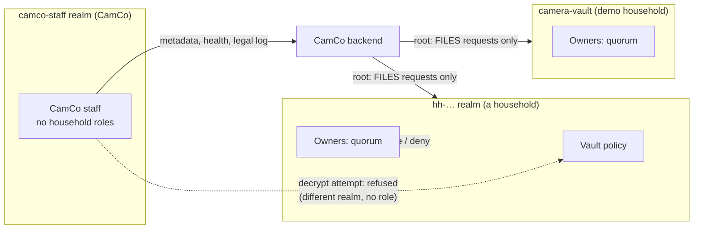

**What staff do: real work, all from metadata**

| Panel | What it gives CamCo | What it never needs |
|---|---|---|
| **Service health** | TideCloak up/down and latency; ORKs reachable out of 20 (needs 14); stored bytes and clip count | footage |
| **Customers** | status and age of each household's setup, cameras, clips, storage, last upload | keys |
| **Re-issue setup link** | rescue a stuck sign-up. Only works while the owner hasn't created their Tide account; afterwards nobody at CamCo can stand in for them | |
| **Camera fleet** | per camera: active/quiet, last seen, events, videos, bytes. Answers "my camera stopped recording" | |
| **Legal & police requests** | logged with requester, reference and scope. The recorded outcome: CamCo can't disclose footage (it holds no key) and refers the requester to the household; metadata can be provided under legal process | |
| **Try to look inside** | the demo tab: raw ciphertext, a refused decrypt, root's self-grant stuck pending, force-approve refused | |

**Transparency to households.** Every vendor action that touches a household (self-grant attempts, force-approve attempts, re-issued setup links, legal requests) is written into **that household's own log**. Members see it under **CamCo activity on your household**.


---

## 23. Household copies: surviving vendor deletion

Tide makes CamCo unable to **read** or **release** footage. It can't stop CamCo **destroying** ciphertext on disks it controls. That's availability, a separate property, so the household keeps its own copies. Ciphertext is safe to copy anywhere: nothing in it opens without the household's Tide-governed key.

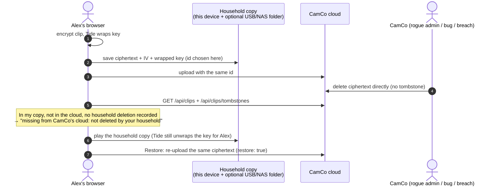

| Piece | Behaviour |
|---|---|
| **This device** | IndexedDB, on by default per household. Written **before** the upload, so an outage loses nothing (the row says "its upload never finished"). |
| **Backup folder** | Optional: a USB drive or NAS share chosen in Chrome or Edge (File System Access API). One `.camvault.json` per clip, holding only ciphertext, IV and wrapped key. If the browser forgets permission between visits, **Allow folder access** asks again. |
| **Copy cloud clips here** | Pulls the ciphertext of clips recorded earlier or on other devices. |
| **Tombstones** | Every household deletion and retention clean-up is recorded on the server. Devices remove their copies of tombstoned clips, so a household deletion still deletes everywhere. |
| **Integrity check** | Each time the panel loads: in this device's copy, not in CamCo's list, no tombstone → flagged, with **View household copy** and **Restore to CamCo's cloud**. |

**Demo:** as CamCo, **Try to look inside** → **Delete ciphertext** on a clip. Then as Alex, **Household copy** shows the clip missing *"not deleted by your household"*. **View household copy** plays it, and **Restore** puts it back.

**Limits.** CamCo runs the server, so it could forge a tombstone. The check would then miss that deletion, but the household's copy would still exist. Signing deletion records with the deleting member's own key would close that gap. Copies already written to a backup folder are left for the household to manage.
